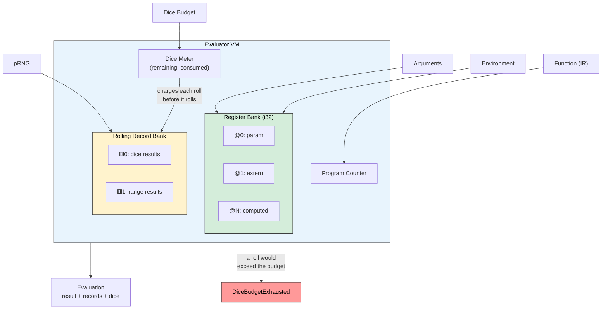
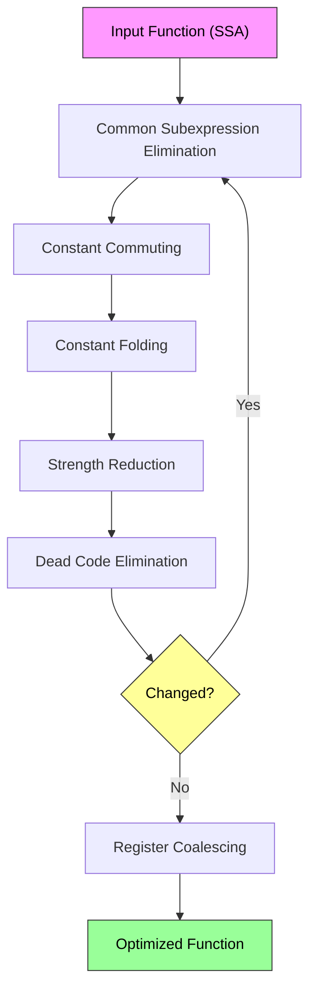
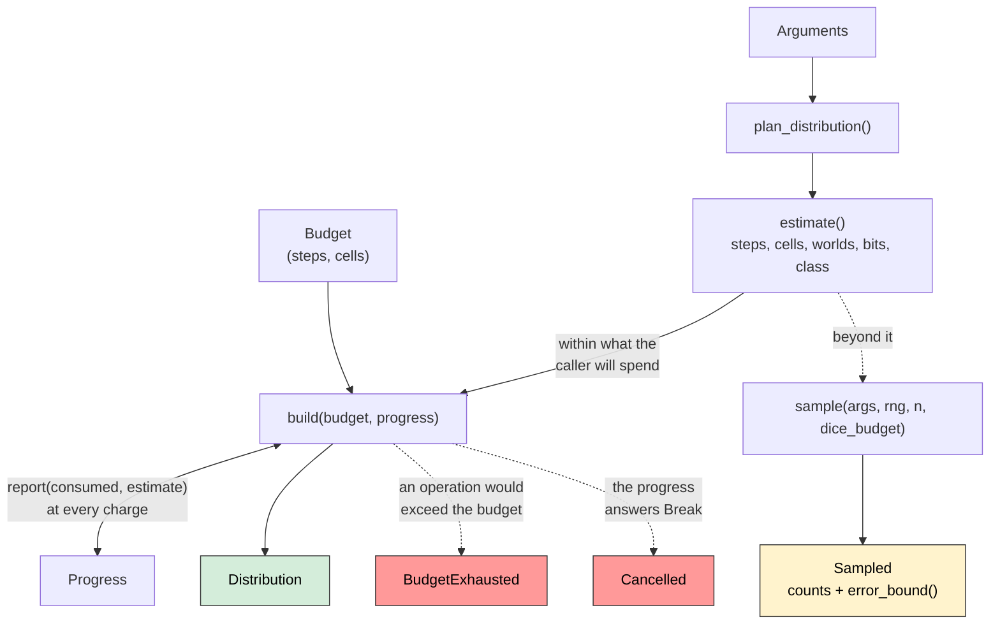
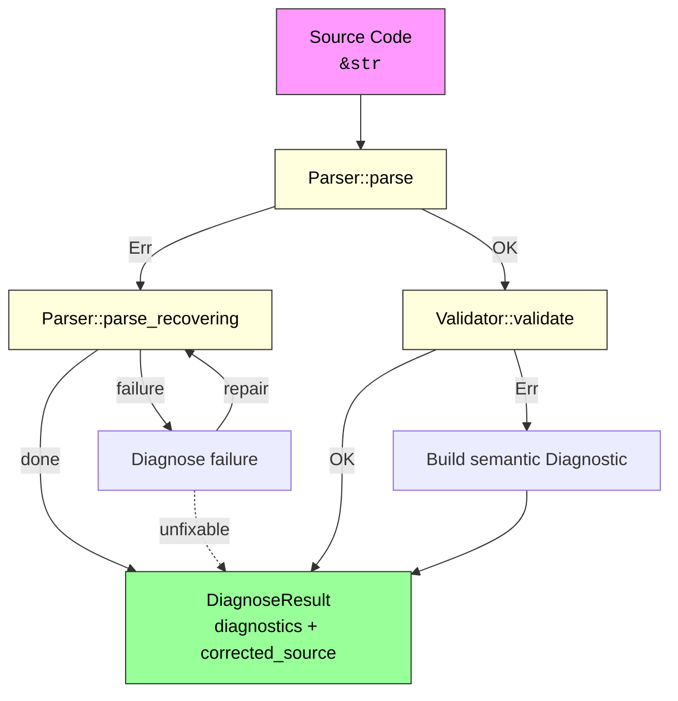

# xDy crate

The `xdy` crate is the core library of the xDy project. It compiles dice expressions into reusable functions, optimizes them, and evaluates them against client-supplied pseudorandom number generators. For a high-level overview of the project, language features, and usage examples, see the [project README](../README.md).

This document covers the internal architecture for contributors and curious power users.

* [Architecture](#architecture)
	* [Compilation pipeline](#compilation-pipeline)
	* [Source spans](#source-spans)
	* [Semantic validation](#semantic-validation)
	* [Intermediate representation](#intermediate-representation)
	* [Evaluator](#evaluator)
	* [Optimizer](#optimizer)
	* [Distribution engine](#distribution-engine)
	* [Diagnostics](#diagnostics)
	* [Textual formats](#textual-formats)
* [Instruction set reference](#instruction-set-reference)
	* [Addressing modes](#addressing-modes)
	* [Roll instructions](#roll-instructions)
	* [Drop instructions](#drop-instructions)
	* [Keep instructions](#keep-instructions)
	* [Reroll instructions](#reroll-instructions)
	* [Explode instructions](#explode-instructions)
	* [Reduce instructions](#reduce-instructions)
	* [Arithmetic instructions](#arithmetic-instructions)
	* [Control instructions](#control-instructions)
* [Cargo features](#cargo-features)
* [Safety](#safety)

## Architecture

### Compilation pipeline

Source code flows through a four-stage happy path: parse, validate, compile, optimize. The `compile()` convenience function drives the full pipeline; `compile_unoptimized()` skips the optimizer; the sad path (syntactic and semantic errors, rich diagnostics) is described in [Diagnostics](#diagnostics).

```mermaid
graph LR
    A["Source Code<br/><code>&str</code>"] --> B["Parser<br/><code>Parser::parse</code>"]
    B --> C["AST<br/><code>ast::Function</code>"]
    C --> V["Validator<br/><code>Validator::validate</code>"]
    V --> D["Compiler<br/><code>Compiler::compile</code>"]
    D --> E["Unoptimized IR<br/><code>Function</code>"]
    E --> F["Optimizer<br/><code>StandardOptimizer</code>"]
    F --> G["Optimized IR<br/><code>Function</code>"]
    style A fill:#f9f,stroke:#333,color:#000
    style G fill:#9f9,stroke:#333,color:#000
```

**Parser.** A [nom](https://docs.rs/nom)-based combinator parser recognizes the xDy grammar and produces an abstract syntax tree (`ast::Function`). The grammar supports operator precedence via recursive descent: `add_sub` → `mul_div_mod` → `unary` → `exponent` → `primary`. The recursive productions share an engine that performs the descent with an explicit stack on the heap, so parsing takes time linear in the length of the input and consumes no more of the machine stack for deeply nested input than for shallow input. See the `parser` module for the full set of production rules; its Rustdoc includes a railroad diagram generated from the EBNF grammar. The diagrams of the grammars, in `doc/`, are committed rather than built, since a build script may write only to its own output directory; `just railroad` regenerates them from `grammar/`, and a test fails while they disagree. Every AST node carries a `SourceSpan` referencing its byte range in the original input — see [Source spans](#source-spans) below.

**Validator.** The `Validator` performs semantic checks on the parsed AST before code generation. It catches duplicate formal parameter names and enforces the invariants of local bindings — use-before-bind (including self-reference), rebinding, and collision with a formal parameter — with room for further checks as downstream language features demand them. See [Semantic validation](#semantic-validation).

**Compiler.** The `Compiler` implements the `ASTVisitor` trait and walks the AST in a single pass to emit IR instructions. An `ASTVisitor` folds the AST bottom-up: optional `enter_*` hooks run before a node's children, and each `visit_*` method runs after them, receiving their outputs. The walk uses an explicit stack rather than recursion, so it handles ASTs of any depth. It uses static single assignment (SSA) form — every instruction writes to a fresh register or rolling record, except that a drop, keep, or reroll instruction rewrites in place the rolling record that it modifies. Every optimizer pass but register coalescing requires this form. Parameters are allocated first (in declaration order), then external variables (depth-first, left-to-right), ensuring deterministic register layout. A call of `highest` or `lowest` evaluates its arguments left to right, then chains `Max` or `Min` over their registers from the left, so `highest(a, b, c)` computes `(a max b) max c`. Keeping validation as a separate pass lets the compiler's `ASTVisitor::Error` be `Infallible`.

**Optimizer.** The `StandardOptimizer` applies five transformation passes in a fixed-point loop, then a final register coalescing pass. See [Optimizer](#optimizer) below.

### Source spans

Every AST node carries a `SourceSpan { start, end }` byte range referencing the original source text. The `Spanned` trait provides uniform access to these spans (`span()`) and an `untethered()` operation that zeroes every span throughout a value, enabling position-independent structural comparison for tests and round-trip fidelity checks.

Spans flow end-to-end: parser combinators compute them from `nom_locate::LocatedSpan` positions; semantic errors (the `CompilationError` variants in the table below) carry the spans of both occurrences that conflict; diagnostics (`Diagnostic`, `RelatedLabel`) surface them as byte ranges in the original source. This layer is a prerequisite for the planned `xdy!` procedural macro (which translates compiler errors to `compile_error!` at token-precise spans) and for editor integrations that want to underline or gutter-highlight errors.

### Semantic validation

The `Validator` pass sits between parsing and code generation and rejects ASTs that are syntactically well-formed but semantically invalid. `Validator::validate()` is its entry point, and runs every check in a single walk. The `Validator` is an `ASTVisitor`, so a walk that drives it through `accept` performs the same checks.

The current checks:

| Error | Example | Payload |
|-------|---------|---------|
| `DuplicateParameter` | `{x}, {x}: {x} + 1` | name, first and duplicate occurrence spans |
| `BindingCollidesWithParameter` | `{x}: {x}@(3D6) + {x}` | name, parameter span, binding-site span |
| `DuplicateBinding` | `{x}@(3D6) + {x}@(1D4)`, `{x}@({x}@(1))` | name, first and duplicate binding-site spans |
| `UseBeforeBind` | `{x} + {x}@(3D6)` | name, reference span, binding-site span |

The binding checks (`BindingCollidesWithParameter`, `DuplicateBinding`, `UseBeforeBind`) enforce the single flat namespace and forward-only reference rules of subexpression naming; `UseBeforeBind` also rejects self-reference inside a bound expression, such as `{x}@(1 + {x})`. Additional checks will be added here as further language features land.

### Intermediate representation

The IR is a simple register transfer language (RTL) with no control flow — all instructions reside in a single basic block. The machine model provides two register files:

- **Register bank** (`@0`, `@1`, …): holds `i32` values for parameters, external variables, and computed intermediates.
- **Rolling record bank** (`⚅0`, `⚅1`, …): holds the individual results of dice rolls and range selections, along with drop counters.

Each operand uses one of three addressing modes:

| Mode | Notation | Description |
|------|----------|-------------|
| Immediate | `N` | Constant `i32` embedded in the instruction |
| Register | `@N` | Index into the register bank |
| RollingRecord | `⚅N` | Index into the rolling record bank |

See [Instruction set reference](#instruction-set-reference) for the complete ISA.

### Evaluator

The evaluator is a linear instruction interpreter. For each evaluation it:

1. Allocates a register bank (sized at compile time) and a rolling record bank.
2. Loads arguments into parameter registers and environment bindings into external variable registers.
3. Walks the instruction stream sequentially — there is no branching, so the program counter simply increments.
4. Returns the final `Evaluation`, which includes the `i32` result, the complete `Vec<RollingRecord>` for display, and the number of dice rolled.

All arithmetic saturates to `i32::MIN`/`i32::MAX`. Division by zero yields zero. `0^0 = 1`. A negative exponent yields zero, except that `1^n = 1` and `(-1)^n = ±1` for every `n`.

`evaluate_metered()` evaluates within a caller-supplied dice budget. The IR never branches, and loops only to roll dice, as a reroll or explode does, so every cost of evaluation beyond the size of the function is proportional to the dice rolled; each roll instruction charges its count against the budget, and each reroll or extension one die, and a charge that would exceed it is refused with `DiceBudgetExhausted` before it draws from the RNG or allocates anything. Within the budget, metering never changes the RNG draws. Every `Evaluation` reports the dice it rolled in `dice`.

The evaluator also provides `bounds_over()`, which computes static `min`/`max` bounds, (when possible) the total outcome count, and the worst-case number of dice rolled — without requiring an RNG.

### Optimizer

The `StandardOptimizer` applies six passes. The first five run in a fixed-point loop; the sixth runs once at the end:

| Pass | Effect |
|------|--------|
| **CSE** | Identifies identical instructions and replaces duplicates with references to the first occurrence |
| **Constant commuting** | Puts immediate operands first in commutative operators, and merges chained constants, e.g., `(x + 1) + 2` → `x + 3` and `min(min(x, 5), 3)` → `min(x, 3)`, wherever the result is exact despite saturation, creating folding opportunities |
| **Constant folding** | Evaluates instructions whose operands are all immediates at compile time, and folds rolls whose results their clauses leave known, e.g., `3D1 reroll = 1` → `3`, `3D6 reroll ≤ 6 ∞ times` → `0`, `3D1 explode = 1 2 times` → `9`, and `3D6 explode ≥ 1 ∞ times` → `2147483647`, whose chains all saturate |
| **Strength reduction** | Replaces expensive operations with cheaper equivalents (e.g., `x * 2` → `x + x`, `1D6` → `[1:6]`, `{x}D1 keep highest 2` → `min(max(x, 0), 2)`, `{x}D1 explode = 1 2 times` → `max(x, 0) * 3`), eliminates a maximum or minimum whose operands' bounds prove that one always wins, e.g., `max(x, 0)` where `x` is the sum of `1D6`, eliminates rerolls that cannot change any die, e.g., the second reroll of `3D6 reroll = 1 ∞ times reroll = 1`, and eliminates explodes that cannot extend any chain, e.g., `3D6 explode = 7`, and the rerolls and explodes after an explode that saturates every chain, e.g., the reroll of `{x}D6 explode ≥ 1 ∞ times reroll = 1` |
| **Dead code elimination** | Removes instructions whose results are never consumed |
| **Register coalescing** | Colors the live ranges of the registers by a linear scan, so that registers whose live ranges do not overlap share one, reducing the register bank size; breaks SSA form, so it runs last |

### Distribution engine

The distribution engine computes the exact probability distribution of a dice expression, for fixed arguments and external variables, in one forward pass over its instructions, in which every register holds the distribution of its value rather than one value. Weights are unbounded integers (`Weight`), so a `Distribution` is exact however many dice it describes.

#### Forward pass

* Each rolling record fuses its roll, drops, keeps, and sum into one operator: a pool without drops sums by powers of its die's distribution under convolution, found by repeated squaring, and a pool with drops sums by order statistics, face by face.
* Each arithmetic instruction combines the distributions of its operands pair by pair, through the same primitives that the evaluator uses, so every edge case of saturation and division is inherited rather than rederived.
* A roll whose count, faces, range endpoints, or drop or keep counts are random fills its record with a weighted mixture of rolls with fixed operands, one for each outcome of its operands.
* A reroll counts its branches as though each die still kept rolled in advance every reroll that it might need, as the count of outcomes of the bounds does. Before any drop or keep, the dice of a roll are independent and alike, so a reroll changes only the law of each die, and the record rolls custom dice that weigh that law; after one, or on results fixed by a split, the reroll enumerates the multisets of the dice still kept, and the record holds the multisets that it leaves, each with its weight. A reroll whose thresholds, endpoints, or limit are random mixes the rerolls of their outcomes.
* An explode extends each die still kept into a [chain](#explode-instructions), whose total behaves as a die's result does. Where no later reroll or explode reads the record, the explode reduces each chain to its total at once, so the record rolls custom dice, or holds the multisets, of totals, which the rest of the pass treats as any other; otherwise, it keeps each chain whole, as the multiset of its kept dice and the die at its end, so that a later reroll rerolls each of its dice alone, and a later explode grows it from its end. A limited explode counts its branches as though each chain still kept rolled in advance every extension that it might need, as the count of outcomes of the bounds does, and an unlimited one that matches every face saturates every chain still kept, rolling nothing. Before any drop or keep, it changes the law of each chain; after one, it enumerates the multisets of the chains still kept, ordered as drops and keeps order them. Later rerolls and explodes act on each chain alone, so they change only the law of what each chain of those multisets has become, and the pass joins the chains again only when a drop, a split, or a sum needs them together.
* Combining operands pair by pair is exact only if they are independent, which fails only where some random value is read more than once. The pass conditions on such a value, as its plan directs: it splits each of its _worlds_, each a complete state of the pass, into one for each outcome of the value, in which the value is fixed, and later merges them, once one value carries the whole influence of the conditioned one, by mixing that value's distributions over the worlds. The worlds of open splits form a stack, merged last in, first out.

Where no roll has random operands, every path through the expression, one branch of every range and die, is equally likely, and every outcome weighs the number of paths that reach it. Elsewhere, paths may be unequally likely, as in `(1D3)D3`, and every outcome weighs its probability over a total that is a multiple of the least common multiple of the paths' denominators.

#### Estimates, budgets, and progress

`Evaluator::plan_distribution()` answers a `DistributionPlan`, whose `estimate()` predicts the cost of the pass before it computes any weight: the steps, the operations on weights; the peak cells, the entries alive at once across every world; the peak worlds; and the bits of the answer's total weight. The estimate shadows the pass over the bounds of each register, and follows the pass's own algorithms rather than pricing them by formula. Where a split fixes the operands of later rolls, as in `{x}@(10D6) + {x}D6`, the estimate prices the split's outcomes apart, in up to 256 lanes that nested splits share fairly, and prices a split of more values than it can spare lanes in buckets of several values, which loosen the estimate gracefully. It never falls below what the pass uses; it is exact on pools of dice with fixed operands, and within a factor of two on every case of the test corpus. It also records the function's `Class`: whether it drops dice, has random roll, drop, keep, or reroll operands, reads a random value more than once, combines two random values by multiplication, division, remainder, exponentiation, maximum, or minimum, whose pairs the pass enumerates, rerolls dice, or explodes them.

A reroll may leave some setups of a mixture as they were, cross out the dice of others, rewrite the law of the dice of others, and pool the multisets of the dice still kept of others, so the estimate bounds the setups of each record by parts, each of one kind. It resolves each reroll against the die from which it draws, value by value where its operands take few values. A rewrite of dice none of which has been dropped follows the pass charge for charge, so its estimate is exact when its operands are fixed. The cost of a pool turns on how many dice still kept each outcome of the roll matches, so the estimate groups the multisets of the roll by the results that the reroll may match, and by those below them, when they lie in one run, as the faces that a comparison or a range matches do; and it charges the costliest groups. The estimate prices every world of a split of a record as its costliest, which is loose for a reroll after such a split, whose cost varies with the results that each world fixes; the compiler never reads a record twice, so only assembled functions split records.

`DistributionPlan::build()` runs the pass within a `Budget` of steps and cells. Every operation charges the most that it may take before it takes any, so one that would exceed the budget is refused, before it expands anything, with `BuildError::BudgetExhausted`, which carries the estimate. The charges depend only on the function and its bindings, so a budget that suffices once always suffices, and one that covers the estimate never refuses. A roll charges its dice when it fills its record, so the budget bounds the number of dice too. An unlimited explode that does not match every face may grow a chain without bound, and has no exact distribution of finite weight, so `build()` refuses every function in which one may extend a chain with `BuildError::Unbounded`, before it charges anything, deciding by the bounds, conservatively; a caller may sample the function instead. The estimate of such a function saturates every quantity, but still classifies the function, as one that explodes, among its other traits. The estimate prices every explode whose chains no later reroll or explode reads, which reduce to their totals at once, whether before or after a drop or keep, and every explode and reroll of chains that stay whole for a later reroll or explode, whether or not some chain has been dropped, or a split has fixed the results; so every function that the pass builds has a finite estimate. After every charge that the budget admits, the pass reports its `Usage` so far, with the estimate, to a `Progress`, which may cancel the build, whereupon it answers `BuildError::Cancelled`; `Unobserved` ignores the reports. In every case, there is no partial distribution.

#### Sampling

When the estimate exceeds what a caller will spend, `Evaluator::sample()` estimates the distribution instead, by evaluating the function `n` times within one dice budget across every evaluation, each metered by `evaluate_metered()` with what the evaluations before it left. It answers `Sampled`, a distinct type rather than a `Distribution` with a flag, so that a sample is never mistaken for an exact answer. Its `error_bound()` is the Dvoretzky–Kiefer–Wolfowitz bound with Massart's constant: at confidence `1 - δ`, the cumulative distribution function of the counts is within `ε = √(ln(2/δ) / 2n)` of the exact one at every outcome at once, for discrete distributions too.

### Diagnostics

The `diagnostics` module is the sad-path counterpart to the [compilation pipeline](#compilation-pipeline): it produces rich `Diagnostic` values — each carrying an error kind, a source span, a human-readable message, optional secondary `RelatedLabel`s, and zero or more `Suggestion`s (edits of the original source, in the manner of an editor's quick fixes, with placeholder regions for the defaults of ambiguous fixes) — designed to power IDE-style error reporting on every keystroke. It runs one of two passes: a **semantic validator pass** when the source parses cleanly, and otherwise a **syntactic pass**, a single recovering parse that diagnoses and repairs each parse error in turn.

**Syntactic pass.** The parser parses the source once more, in a recovery mode: wherever the parse cannot continue, the doctor diagnoses the failure and, if it can, repairs it, so that the parse continues as though the source had been edited by the fix — e.g., as though a missing `)` were present. The parser never edits the source, but reads its stray whitespace — whitespace between tokens other than spaces, tabs, and line breaks, e.g., U+00A0 NO-BREAK SPACE pasted from a word processor — as spaces of the same length, and the doctor offers to replace each with a space. So every span and edit is a position of the original source, and the pass takes time linear in the length of the source, however many errors it holds. It ends when the parse succeeds or when an unfixable error is encountered. Sources in the older syntax, whose formal parameters and local bindings were bare names, e.g., `x, y: {x} + {y}` and `x@(3D6)`, get fixes that brace the names, e.g., `{x}, {y}: {x} + {y}` and `{x}@(3D6)`.

**Semantic pass.** Instead, the doctor runs the `Validator` on the parsed AST — but **only when the original source parsed cleanly**, that is, when no fixes were applied. Semantic diagnostics point at spans the user actually typed; running the validator on a fix-synthesized source would attach diagnostics to characters the user never wrote, which is confusing, so semantic checks wait for a syntactically valid source.

### Textual formats

Two modules give the compiler's data structures textual forms that read back exactly, which the test corpora under `tests/` rely on:

- **S-expressions.** The `s_expr` module writes an AST as an S-expression, e.g., `(function [] (add (standard-dice 3 6) 1))` for `3D6 + 1`, optionally with its source spans, and reads one back. Its reader and writer use explicit stacks, so they handle trees of any depth.
- **Assembly.** An IR `Function`'s `Display` produces the notation of the [instruction set reference](#instruction-set-reference), and the assembler reads it back into a `Function`, enforcing the bounds and contiguity of the register files so that the evaluator can run the result safely. Its Rustdoc gives the grammar and a railroad diagram.

Both formats brace every name, and read only canonical names, as their writers emit.

## Instruction set reference

### Addressing modes

| Mode | Syntax | Description |
|------|--------|-------------|
| `Immediate(N)` | `N` | Constant `i32` value |
| `Register(N)` | `@N` | General-purpose register |
| `RollingRecord(N)` | `⚅N` | Rolling record (dice/range results) |

### Roll instructions

| Instruction | Syntax | Semantics |
|-------------|--------|-----------|
| `RollRange` | `⚅N <- roll range S:E` | Select a random value from the inclusive range `[S, E]` and store it in rolling record `N` |
| `RollStandardDice` | `⚅N <- roll standard dice CDF` | Roll `C` standard dice with `F` faces each, storing all results in rolling record `N` |
| `RollCustomDice` | `⚅N <- roll custom dice CD[f₁, f₂, …]` | Roll `C` custom dice with the specified face values, storing all results in rolling record `N` |

### Drop instructions

| Instruction | Syntax | Semantics |
|-------------|--------|-----------|
| `DropLowest` | `⚅N <- drop lowest K from ⚅N` | Of the results of rolling record `N` still kept, cross out the `K` lowest; a `K` of zero or less drops nothing |
| `DropHighest` | `⚅N <- drop highest K from ⚅N` | Of the results of rolling record `N` still kept, cross out the `K` highest; a `K` of zero or less drops nothing |

After an explode, a drop counts each [chain](#explode-instructions) still kept as one result, worth its total, and crosses out every result of each chain that it crosses out. Of equal results, a drop crosses out the first rolled, and of chains of equal totals, it compares their kept results in ascending order, and then the results at their ends, before the order rolled. The record keeps every result, crossed out or not, in the order rolled. Consecutive drops leave the same results kept in either order, but a drop does not commute with a keep, a reroll, or an explode.

### Keep instructions

| Instruction | Syntax | Semantics |
|-------------|--------|-----------|
| `KeepLowest` | `⚅N <- keep lowest K from ⚅N` | Of the results of rolling record `N` still kept, cross out all but the `K` lowest, from the high end; a `K` of zero or less keeps nothing |
| `KeepHighest` | `⚅N <- keep highest K from ⚅N` | Of the results of rolling record `N` still kept, cross out all but the `K` highest, from the low end; a `K` of zero or less keeps nothing |

A keep counts from the results that earlier drops and keeps left kept, so, unlike drops, keeps do not commute with drops or with each other: of `4D6`, dropping the lowest and then keeping the lowest 2 keeps the second and third lowest results. Like a drop, a keep counts chains and breaks ties between them, and crosses out the results that it does not keep, so a rolling record shows the dice that keeps and drops crossed out alike, as `Fate::Dropped`.

### Reroll instructions

| Instruction | Syntax | Semantics |
|-------------|--------|-----------|
| `Reroll` | `⚅N <- reroll P L from ⚅N` | Reroll each result of rolling record `N` still kept that satisfies predicate `P`, up to limit `L` times |

The predicate `P` is a comparison with a threshold, `= T`, `!= T`, `< T`, `<= T`, `> T`, or `>= T`; a list of literals, `in [v₁, v₂, …]`; or a half-open or inclusive range, `in S..E` or `in S..=E`, which is empty if it is inverted. The limit `L` is `up to K times`, where a `K` of zero or less rerolls nothing, or `unlimited times`. The thresholds, endpoints, and `K` are read once, before the first reroll.

A reroll considers the results still kept when it begins, in the order rolled, and finishes each before it begins the next: it crosses out a matching result, rolls its replacement from the same die, and appends the replacement to the record, linked to the result that it replaces, repeating while the replacement matches and the limit allows. An unlimited reroll whose predicate matches every face of the die rolls nothing, but crosses out every matching result, so that each contributes zero. A die without faces, or an empty range, shows only the face `0`.

The bounds of a reroll are exact: an unlimited reroll narrows the results still kept to the faces that its predicate cannot match, over the bounds of its thresholds and endpoints, and may cross out every die only if its predicate may match every face. The count of outcomes counts each reroll as though each die still kept rolled in advance every reroll that it might need, so that every path is equally likely: a reroll limited to `K` times multiplies it by the branches of the die raised to `K`, and an unlimited reroll by the branches that its predicate does not match, both once for every die still kept, and a reroll that cannot happen leaves it unchanged.

### Explode instructions

| Instruction | Syntax | Semantics |
|-------------|--------|-----------|
| `Explode` | `⚅N <- explode P L from ⚅N` | Extend each chain of rolling record `N` still kept whose last result satisfies predicate `P` with another die, up to limit `L` times |

The predicate `P` and the limit `L` take the same forms as those of a reroll, and are read once, before the first explosion.

An explode considers the results still kept when it begins, in the order rolled, and finishes each before it begins the next: it rolls an extension of a matching result from the same die, and appends the extension to the record, linked to the result that it extends, which stays kept, repeating while the extension matches and the limit allows. The results that descend from one rolled result, by the links of extensions and replacements, form a _chain_, and the sum and every later drop and keep count each chain still kept as one result, worth its total, so that a drop or keep crosses out a chain whole. A chain grows only from its end: an explode skips every result that some other result extends, and a replacement takes the place of the result that it replaces in its chain, so a later reroll acts on each result of a chain alone, and a later explode extends only the end of each chain. An unlimited explode whose predicate matches every face of the die rolls nothing, but appends to every matching result one _saturated_ result, which stands for the endless chain, and which is worth `i32::MAX` or `i32::MIN` by the sign of the mean face value, or `0` if that mean is `0`; a saturated result decides the total of its chain, prints as `∞` or `-∞`, and costs no dice. Later rerolls and explodes leave saturated chains alone. A die without faces, or an empty range, shows only the face `0`.

The bounds of explodes, and of the rerolls and explodes that follow them, are exact within their budgets. They track the shapes of the chains that each die of a record may leave: runs of middle dice, each die of which may show any of a set of results, and each run any number of dice within a range; and the results that the end of a chain, the die that no die extends, may show. A later reroll acts on each die of a chain alike, so it maps the results of every run and of the end. An explode extends only the end, so a chain whose end it does not match stays as it was, and one whose end it matches gains a run of the dice that it matches, and a new end, which it does not match unless the limit is spent. A chain's total never decreases as any of its dice grows, nor moves against the sign of a die as their number grows, so the least and greatest totals of a shape show the extreme result of each run, at the extreme number of its dice. So `1D[-1, 3] explode = 3 1 times reroll = -1` totals at least `-1`, since a chain whose `-1` the reroll leaves holds no `3`, and `1D6 explode = 6 explode = 5` at most `17`. Every die of a chain is the same die, matched by the same criterion, so where the operands of the roll admit at most 1024 dice, and those of a predicate few enough criteria to transform every shape of every die by each within 1024, the bounds transform each pair alone, and unite the answers; beyond that, they transform every die, or every criterion, at once. Shapes that differ in one part unite, and beyond 64 shapes for one die, the bounds coarsen them into one. Either fallback is sound, but may be loose, and so are the bounds of two clauses that read the same register, which they treat as independent. An unlimited explode that may extend a chain by a positive face may total `i32::MAX`, and one that may extend it by a negative face saturates at `i32::MIN` before the chain's other dice lift it again, as `1D[-1, 1, 1, 3] explode = -1 ∞ times` bounds its total below by `i32::MIN + 1`. One that matches every face saturates every chain that no saturated die decides, bounding it by its saturated value, and later rerolls and explodes leave saturated chains alone; an unlimited reroll that matches every face crosses out every die of every other chain, so the record may keep none. The count of outcomes counts a limited explode as though each chain still kept rolled in advance every extension that it might need, as for a limited reroll, multiplying it by the branches of the die raised to the limit, once for every chain still kept; an unlimited explode that may roll gives up counting, and an explode that cannot happen, or that saturates, leaves the count unchanged. A later reroll or explode of an exploded record that may match acts on each die of a chain, or on its end, so it gives up counting. A later limited explode bounds the dice rolled by its limit for every chain still kept, if the end of some chain may match, and a later limited reroll by its limit for each kept die of a chain that may match, for every chain still kept: `4D6 explode = 6 1 times reroll = 1` rolls at most `12` dice, since the `6` from which a chain grows never shows `1`. Strength reduction eliminates a maximum or minimum by these bounds, so it sees explosion: `highest(3D6 explode = 6, 3)` reduces to the roll, but `lowest(3D6 explode = 6, 18)` does not, since the roll may exceed `18`. Constant folding folds a roll whose explodes leave its result known: one whose clauses keep no chain, one whose chains still kept an unlimited explode that matches every face saturated, whatever its faces, and one of dice with one face whose explodes match or miss it a known number of times. Strength reduction eliminates explodes that cannot extend any chain, and reduces a roll of dice with one face to its count of dice times the total of each chain, if its rerolls and explodes leave that known, as constant folding does for constant counts, but never combines drops across an explode, and the [forward pass](#forward-pass) refuses only functions in which an unlimited explode that does not match every face may extend a chain.

### Reduce instructions

| Instruction | Syntax | Semantics |
|-------------|--------|-----------|
| `SumRollingRecord` | `@N <- sum rolling record ⚅M` | Sum the results of rolling record `M` that no drop, keep, or reroll crossed out into register `N`, counting each [chain](#explode-instructions) as its total (saturating) |

### Arithmetic instructions

All arithmetic instructions saturate on overflow/underflow.

| Instruction | Syntax | Semantics |
|-------------|--------|-----------|
| `Add` | `@N <- A + B` | Saturating addition |
| `Sub` | `@N <- A - B` | Saturating subtraction |
| `Mul` | `@N <- A * B` | Saturating multiplication |
| `Div` | `@N <- A / B` | Saturating division; `x / 0 = 0` |
| `Mod` | `@N <- A % B` | Saturating remainder; `x % 0 = 0` |
| `Exp` | `@N <- A ^ B` | Saturating exponentiation; `0^0 = 1`, `1^n = 1`, `(-1)^n = ±1`, and otherwise `x^(-n) = 0` |
| `Max` | `@N <- A max B` | The greater of `A` and `B`; `highest(…)` chains it over its arguments, and the optimizer uses it to clamp, e.g., a negative count of dice to `0`, without rolling |
| `Min` | `@N <- A min B` | The lesser of `A` and `B`; `lowest(…)` chains it over its arguments, and the optimizer uses it to cap, e.g., a count of dice at the count that a keep keeps, without rolling |
| `Neg` | `@N <- -A` | Saturating negation |

### Control instructions

| Instruction | Syntax | Semantics |
|-------------|--------|-----------|
| `Return` | `return A` | Set the function result to `A` and terminate |

## Cargo features

| Feature | Default | Description |
|---------|---------|-------------|
| `serde` | Yes | `Serialize`/`Deserialize` for the IR, the evaluator and its evaluations, distributions and their weights, costs, budgets, usage, and samples, refusing malformed input; not for probabilities, rational numbers, or errors |
| `bench` | No | Exposes the `support` module to the benchmarks, which refuse to run without it; for development only |

## Safety

See [Safety](../README.md#safety) in the project README, which covers saturating arithmetic, stack use on deeply nested input, the budgets that bound evaluation and distributions, and the crate's one use of `unsafe`, which Miri checks.
